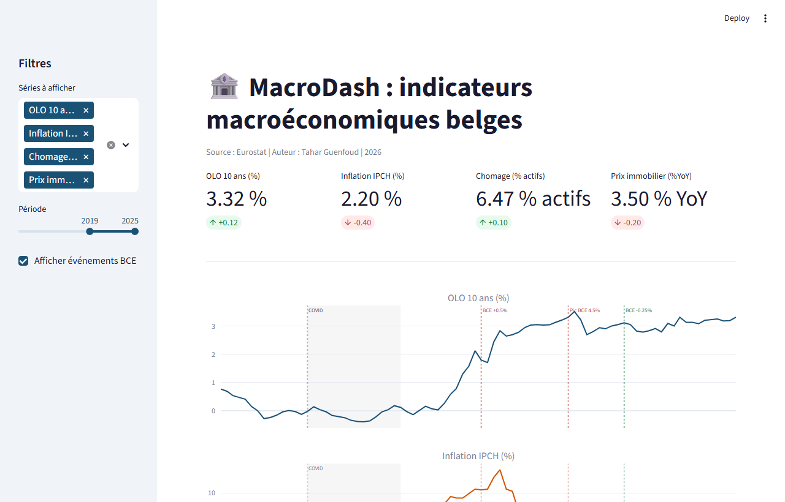

# MacroDash NBB

Dashboard macroéconomique de la Belgique construit sur l'API Eurostat : [macrodashnbb.streamlit.app](https://macrodashnbb.streamlit.app/)

La Banque Nationale de Belgique a mis son API hors service en mars 2026. Eurostat publie les mêmes séries belges via une API JSON gratuite, donc le projet repart de là. Il montre comment la hausse des taux de la BCE (0 % à 4,5 % entre juillet 2022 et septembre 2023, première baisse en juin 2024) se retrouve dans l'économie belge.



## Séries

| Clé | Code Eurostat | Contenu | Fréquence |
|---|---|---|---|
| `olo_10y` | `irt_lt_mcby_m` | OLO belge 10 ans | mensuelle |
| `euribor_3m` | `irt_h_mr3_m` | EURIBOR 3 mois | mensuelle, jusqu'en 2014 |
| `inflation` | `prc_hicp_manr` | inflation IPCH | mensuelle |
| `chomage` | `une_rt_m` | taux de chômage | mensuelle |
| `pib` | `nama_10_gdp` | PIB en MEUR | trimestrielle |
| `prix_immo` | `ei_hppi_q` | prix immobiliers | trimestrielle |

L'EURIBOR 3 mois n'existe sur Eurostat que jusqu'à fin 2014 (taux passés sous zéro). Pour 2022-2024, c'est l'OLO 10 ans qui montre le cycle.

## Ce que montrent les données

- OLO 10 ans : de -0,15 % en 2020 à +3,3 % en 2025.
- Inflation IPCH : 10,3 % en moyenne annuelle 2022, sous 3 % en 2025.
- Prix immobiliers : +7 % sur un an en 2021, +2 % en 2023.
- Corrélations de Pearson (2010-2025) : OLO x EURIBOR +0,73, EURIBOR x PIB -0,83, chômage x PIB -0,75, OLO x prix immobiliers -0,30.

## Fonctionnement

`fetch_eurostat.py` appelle l'API et reconstruit les indices du tableau JSON-stat aplati par la formule des strides. `transform.py` passe tout au mois (les séries trimestrielles sont prolongées par forward-fill), `persist.py` stocke le résultat dans DuckDB et `app/Home.py` affiche KPIs, graphiques Plotly et matrice de corrélation.

Trois changements de l'API Eurostat en 2026 ont demandé des corrections : le paramètre `lang=EN` est refusé, `endPeriod` devient obligatoire avec `startPeriod`, et les filtres de dimensions en paramètres de requête sont refusés (le filtrage se fait en pandas).

```
src/        config, client Eurostat, transformation, DuckDB
app/        Home.py, application Streamlit
notebooks/  exploration et corrélations
docs/       capture du dashboard
```

## Lancer

```bash
pip install -r requirements.txt
streamlit run app/Home.py
```

Le premier lancement interroge Eurostat (environ 10 secondes) puis garde un cache dans `data/raw/`.

Tahar Guenfoud, [github.com/Proftg](https://github.com/Proftg)
